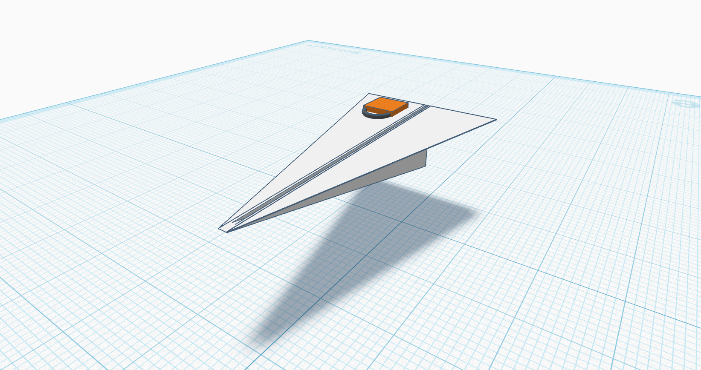

# PrivéChat
Una aplicación de mensajería privada basada en la red I2P.
## La pieza
Como este es un proyecto que no requiere nada físico (excepto obviamente un dispositivo móvil), esta pieza sirve un rol ilustrativo de la función del proyecto: mensajería (el avión de papel) privada (el candado en el ala).
## Medidas y materiales
Esta pieza sólo necesita plástico y sus medidas son las siguientes:

## Componentes
#### Daemon
La app hace uso de un enrutador "daemon" que corre de fondo para conectar al usuario con el resto de la red. Este es el componente clave que hace especial al proyecto y viene integrado con la aplicación para
mejorar la experiencia del usuario.
#### Escáner de huella digital
Opcionalmente, se requiere de hardware adicional para el uso de la autenticación biométrica, que facilita el desbloqueo de los chats sin hacer uso de un PIN.
# Preview de la pieza

